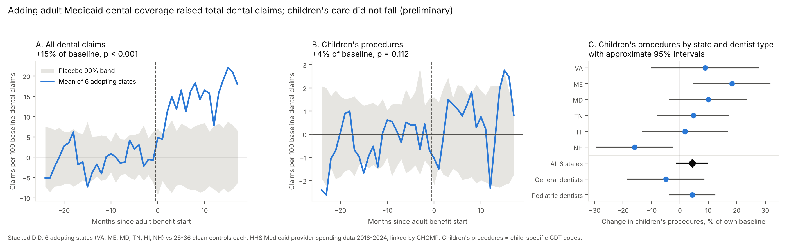

# Adult Medicaid dental coverage and children's dental care

**Question.** When a state adds adult Medicaid dental coverage, what happens to children's Medicaid dental care? Parents who gain coverage may bring their children in more often (Lipton 2021, JHE; Hill, Jones and Chi 2022, Med Care). Dentists who see both age groups may also give chair time to newly covered adults at children's expense. Buchmueller, Miller and Vujicic (AEJ: Policy 2016) found no crowding out of privately insured patients; Medicaid children have not been tested at the provider level across states.

**Status.** Preliminary. Policy dates and several design choices still need human review before publication; see [`TODO.md`](TODO.md).



## Findings so far

Pooled over six adopting states, in claims per 100 of each state's baseline monthly dental claims:

| Outcome                        | Change | % of own baseline | Permutation p |
| ------------------------------ | -----: | ----------------: | ------------: |
| All dental claims              |  +15.0 |              +15% |       < 0.001 |
| Adult-only procedure codes     |  +0.35 |             +313% |       < 0.001 |
| D1110 cleanings (age 14+)      |  +1.86 |              +44% |       < 0.001 |
| Children's procedure codes     |  +1.05 |               +4% |          0.11 |
| Children's, general dentists   |  −0.31 |               −5% |          0.45 |
| Children's, pediatric dentists |  +0.42 |               +4% |          0.28 |

1. Adults came in: adult-only codes and D1110 rise within three months of each start date and stay up. Small-cell suppression hides much adult volume, so these are lower bounds.
2. Children's care did not fall on average. The approximate 95% interval is −1% to +10% of children's baseline volume.
3. NH is the exception: children's procedures fell 16% (p = 0.04), and its adult claims start rising before its listed start date. Its date and data need checking before any conclusion.
4. Children's care dipped at general dentists and rose at pediatric dentists, the pattern displacement would produce. Neither change is statistically reliable, and the gap has not been tested directly.

Both robustness checks (strict data quality; dropping controls flagged by the falsification check) give the same picture. See `output/did_sensitivity.csv`.

## Reproduce

```bash
python analysis/adult_dental_spillover/build_code_panel.py --merged path/to/merged_hhs_nppes_geo.csv
```

```bash
python analysis/adult_dental_spillover/prelim.py && python analysis/adult_dental_spillover/figure.py
```

The first step needs the CHOMP merged claims file (about 23M rows, not in git) and writes `output/code_panel_state.csv` (committed) and `output/code_panel_provider.parquet` (per-dentist, never committed). The second runs from a fresh clone in under a minute. `prelim.py` stops if the code panel's state-month totals do not match CHOMP's published totals exactly.

| File                       | Contents                                                               |
| -------------------------- | ---------------------------------------------------------------------- |
| `policy_events.csv`        | Every policy event the rules use, with date and source                 |
| `design.py`                | The four selection rules                                               |
| `build_code_panel.py`      | Splits claims into child, adult, D1110 and mixed codes by dentist type |
| `prelim.py`                | Estimation, inference, event-study plots                               |
| `figure.py`                | The summary figure above                                               |
| `output/design_stacks.csv` | Treated states, windows, controls, and why every other state is out    |
| `output/did_estimates.csv` | Estimates by outcome and state                                         |

## Design

Stacked difference-in-differences (Cengiz, Dube, Lindner and Zipperer 2019; Wing, Freedman and Hollingsworth 2024). Each adopting state is its own sub-experiment, compared only with states that had no policy change in its window. Four rules, identical for every state:

1. **Policy events.** Every event is a row in `policy_events.csv`. `adopt` = the state starts covering routine cleanings for all non-pregnant adults; `expand` = any other adult dental benefit change; `aca` = ACA Medicaid expansion.
2. **Window.** 24 months before and 18 after adoption, entirely inside the data (2018-01 to 2024-09).
3. **Clean window.** No state in a sub-experiment, treated or control, has any other policy event inside the window.
4. **Usable data.** No CMS DQ Atlas "Unusable" rating for Claims Volume – OT or Procedure Codes – OT Professional (two of the three topics CMS uses in its own dental reporting), and no change of more than 1.5× in average monthly claims between consecutive half-years.

Result: VA (2021-07), ME (2022-07), MD, TN and HI (2023-01) and NH (2023-04), each with 26 to 36 controls. DE and WV fail rule 4, OK and KS fail rule 3, GA fails rule 2.

## Methods

- **Outcome scale.** Monthly claims per 100 of the state's own average monthly dental claims in the 24 pre-adoption months. One scale for every outcome, so adult and child changes are comparable and zero counts need no special handling.
- **Estimate.** 2×2 DiD per sub-experiment (post minus pre gap between the treated state and its controls' mean), averaged with equal weights.
- **Inference.** Permutation: each control is re-run as a placebo within its sub-experiment; the pooled p-value uses 5,000 draws of distinct placebo states. Intervals are ±1.96 placebo SDs.
- **Exclusions.** COVID shutdown months (2020-03 to 2020-06) are dropped from every calculation. Data end 2024-09 to avoid the late-2024 claims lag.
- **Codes.** Children: D0145, D1120, D1351, D1208, space maintainers, D2930, D3220/D3230/D3240. Adults: D4341/D4342, D4355, D4910, dentures and denture adjustments and relines. D1110 is kept separate because it is billed from about age 14. Dentist type comes from NPPES primary taxonomy (pediatric 1223P0221X, general 1223G0001X).

## Limitations

Geography is the provider's practice address. HHS suppresses cells under 12 claims or beneficiaries. Most policy dates come from secondary sources. The 2023 adoptions overlap the end of pandemic continuous Medicaid enrollment. See CHOMP's [`docs/LIMITATIONS.md`](../../docs/LIMITATIONS.md) for the data ledger.
